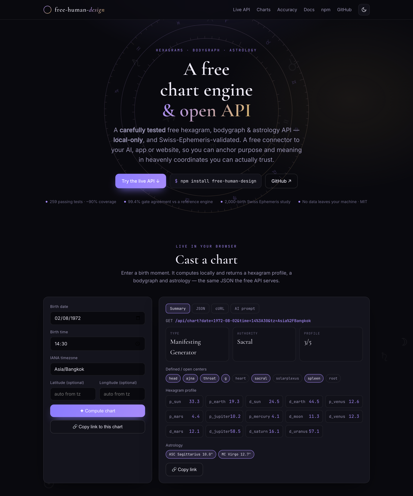
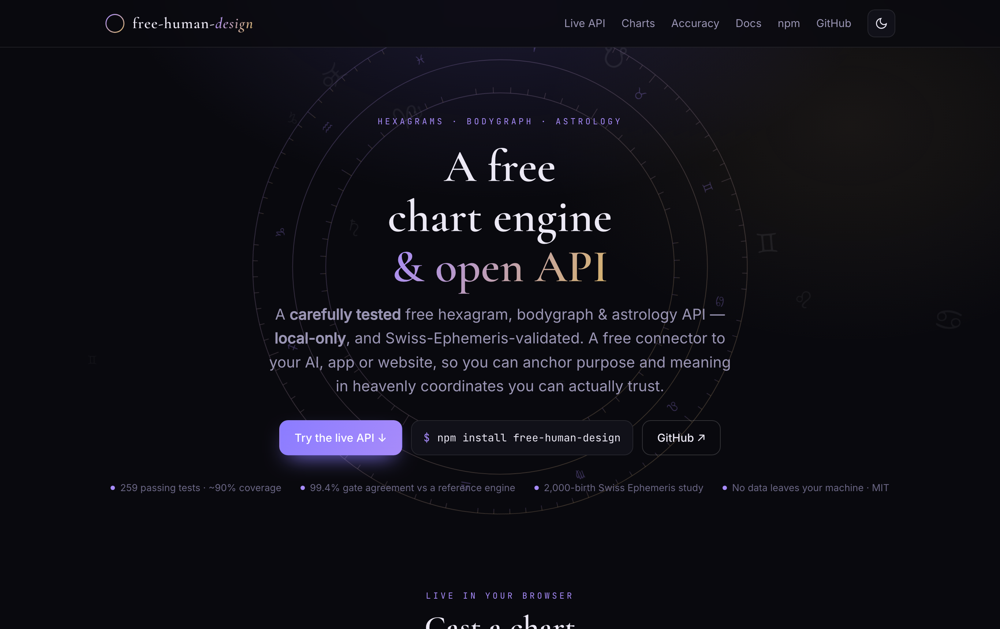
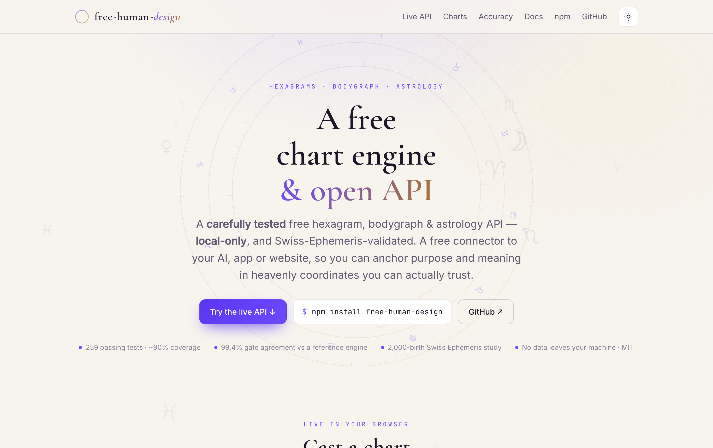

# free-human-design

> npm package: [`free-human-design`](https://www.npmjs.com/package/free-human-design) · live site: [freehumandesign.netlify.app](https://freehumandesign.netlify.app)

[](https://www.npmjs.com/package/free-human-design)
[](#tests)
[](#tests)
[](LICENSE)
[](package.json)
[](#accuracy--precision)

**A free, open-source bodygraph and hexagram profile engine in pure JavaScript, with extended astrology. Carefully tested, and compared against established chart engines.**

From a birth date, time and timezone (and an optional location), `free-human-design`
computes:

- 🧬 **Hexagram profile**: the I-Ching hexagram and line for fourteen planetary
  placements (`p_sun`, `d_earth`, `p_jupiter`, `d_moon`, …).
- ⚡ **Bodygraph**: the full chart: every planetary gate activation
  (13 bodies × Personality + Design), **activated gates**, **defined channels**,
  **defined centers**, **open centers**, and the derived **Type**, **Authority**,
  **Profile** and **Definition**.
- 🪐 **Astrology** — **Ascendant**, **Descendant**, **Midheaven (MC)**,
  **IC**, and house cusps (**Placidus**, **Whole Sign** or **Equal**).

It is **pure JavaScript** — no native build, no `node-gyp`, and **no ephemeris
data files**. Planetary positions come from the MIT-licensed
[`astronomia`](https://github.com/commenthol/astronomia) package (VSOP87 + lunar
theory), validated to the exact gate/line against Swiss Ephemeris.

<p align="center">
  
</p>

```bash
npm install free-human-design
```

---

## Quickstart

```js
const { computeChart } = require('free-human-design');

const chart = computeChart({
  birthdate: '1972-08-02',   // YYYY-MM-DD (or YYYY-M-D)
  birthtime: '14:30',        // HH:mm (or H:mm, or HH:mm:ss)
  timezone: 'Asia/Bangkok',  // any IANA timezone
  // location: { lat: 13.75, lng: 100.5 }, // optional — see "Location" below
  // houseSystem: 'placidus',              // 'placidus' | 'whole' | 'equal'
});

console.log(chart.bodygraph.type);          // 'Manifesting Generator'
console.log(chart.bodygraph.authority);     // 'Sacral'
console.log(chart.bodygraph.profile);       // '3/5'
console.log(chart.hexagrams.p_sun); // { hexagram: 33, line: 3 }
console.log(chart.astrology.angles.ascendant.sign); // 'Sagittarius'
```

`computeChart` returns three coherent sections:

```jsonc
{
  "input": {
    "birthdate": "1972-08-02", "birthtime": "14:30", "timezone": "Asia/Bangkok",
    "birth_utc": "1972-08-02T07:30:00.000Z",
    "location": { "lat": 13.75, "lng": 100.52, "city": "Bangkok", "source": "timezone-city" }
  },

  "hexagrams": {
      "p_sun": { "hexagram": 33, "line": 3 },
      "p_earth": { "hexagram": 19, "line": 3 },
      "d_sun":  { "hexagram": 24, "line": 5 },
      "d_earth":   { "hexagram": 44, "line": 5 },
      "p_venus": { "hexagram": 12, "line": 6 }, "p_mars": { "hexagram": 4, "line": 4 },
      "p_jupiter": { "hexagram": 10, "line": 2 }, "p_mercury": { "hexagram": 4, "line": 1 },
      "d_moon": { "hexagram": 11, "line": 3 }, "d_venus": { "hexagram": 12, "line": 3 },
      "d_mars": { "hexagram": 12, "line": 1 }, "d_jupiter": { "hexagram": 58, "line": 5 },
      "d_saturn": { "hexagram": 16, "line": 1 }, "d_uranus": { "hexagram": 57, "line": 1 }
  },

  "bodygraph": {
    "type": "Manifesting Generator",
    "authority": "Sacral",
    "profile": "3/5",
    "definition": "single",
    "definitionGroups": 1,
    "channelCount": 6,
    "definitionCount": 6, // deprecated: the channel count, see below
    "activatedGates": [4, 10, 11, 12, 16, 19, 24, 33, 34, 44, 45, 46, 48, 51, 56, 57, 58, 60, 61, 62],
    "definedChannels": [{ "key": "10-34", "gates": [10, 34], "centers": ["g", "sacral"], "name": "Exploration" }, "…"],
    "definedCenters": ["head", "ajna", "throat", "g", "sacral", "spleen"],
    "openCenters": ["heart", "solarplexus", "root"],
    "centers": { "head": true, "ajna": true, "…": "…" },
    "p_": { "sun": { "gate": 33, "line": 3, "color": 1, "retrograde": false, "longitude": 130.09, "…": "…" }, "…": "…" },
    "d_": { "…": "…" },
    "activations": { "personality": [ "…13 bodies…" ], "design": [ "…13 bodies…" ] }
  },

  "astrology": {
    "location": { "lat": 13.75, "lng": 100.52, "city": "Bangkok" },
    "angles": {
      "ascendant":  { "longitude": 249.99, "sign": "Sagittarius", "degInSign": 9.99, "gateLine": { "gate": 9, "line": 5 } },
      "descendant": { "sign": "Gemini",      "…": "…" },
      "mc":         { "sign": "Virgo",       "…": "…" },
      "ic":         { "sign": "Pisces",      "…": "…" }
    },
    "houses": { "system": "placidus", "cusps": [ { "house": 1, "longitude": 249.99, "sign": "Sagittarius" }, "…" ] }
  }
}
```

If no location can be resolved, `astrology` is `null` (everything else still
computes — astrology is the only part that needs a place of birth).

---

## 🌐 Free API & live site

**[freehumandesign.netlify.app](https://freehumandesign.netlify.app)** — a free, local-only
API and an in-browser playground. Every endpoint is a plain `GET` with open CORS,
so you can call it from a browser, a notebook, or hand it straight to an AI.

<p align="center">
  
</p>

```bash
curl "https://freehumandesign.netlify.app/api/chart?date=1972-08-02&time=14:30&tz=Asia/Bangkok"
```

| Endpoint | Returns |
| --- | --- |
| `/api/chart` | Full chart — hexagram profile + bodygraph + astrology |
| `/api/hexagrams` | profile placements |
| `/api/bodygraph` | bodygraph |
| `/api/astrology` | Ascendant / MC / houses |
| `/api/midpoints` | Advanced — the [midpoint matrix](#-midpoints-advanced) over the 26 activations |
| `/api/prompt` | A ready-to-paste **AI interpretation prompt** |
| `/api/timezones?q=bali` | IANA timezone search |

Params: `date=YYYY-MM-DD` · `time=HH:mm` · `tz=IANA` · `[lat lng house=placidus|whole|equal midpoints=1]`

Dark and light, fully responsive:

| Dark | Light |
| --- | --- |
|  |  |

The site and API live in [`site/`](site) and [`netlify/functions/`](netlify/functions);
the deploy config is [`netlify.toml`](netlify.toml). Nothing about a birth ever
leaves the function — the ephemeris is computed in-process.

---

## The three layers

### 🧬 Hexagram profile

Each placement carries its I-Ching hexagram (1–64) and line (1–6), mapped from a
planet at the Personality (birth) or Design (~88° of solar arc before birth)
moment. Keys are `p_<body>` for Personality and `d_<body>` for Design:

| Key | Source | Key | Source |
| --- | --- | --- | --- |
| `p_sun` | Personality Sun | `d_moon` | Design Moon |
| `p_earth` | Personality Earth | `d_venus` | Design Venus |
| `d_sun` | Design Sun | `d_mars` | Design Mars |
| `d_earth` | Design Earth | `d_jupiter` | Design Jupiter |
| `p_venus` | Personality Venus | `d_saturn` | Design Saturn |
| `p_mars` | Personality Mars | `d_uranus` | Design Uranus |
| `p_jupiter` | Personality Jupiter | `p_mercury` | Personality Mercury |

### ⚡ Bodygraph

The bodygraph is derived from **26 activations** — 13 bodies (Sun, Earth, Moon,
North/South Node, Mercury, Venus, Mars, Jupiter, Saturn, Uranus, Neptune, Pluto)
at both the Personality and Design moments:

```js
const { computeChart } = require('free-human-design');
const hd = computeChart({ birthdate: '1972-08-02', birthtime: '14:30', timezone: 'Asia/Bangkok' }).bodygraph;

hd.activatedGates;   // [4, 10, 11, … ]  — every gate lit by a planet
hd.definedChannels;  // channels where BOTH gates are activated
hd.definedCenters;   // centers touched by a defined channel
hd.openCenters;      // the rest
hd.type;             // Generator | Manifesting Generator | Projector | Manifestor | Reflector
hd.authority;        // Emotional | Sacral | Splenic | Ego | Self-Projected | Mental | Lunar
hd.profile;          // e.g. '3/5'  (Personality Sun line / Design Sun line)
hd.definition;       // none | single | split | triple split | quadruple split
hd.definitionGroups; // 0–4: how many separate groups the defined centers form
hd.channelCount;     // how many channels are defined
```

**Definition** counts the separate groups of defined centers, with the defined
channels as the links between them; it is not the number of channels. The
1992-12-09 00:35 Brussels chart has three channels (47-64, 11-56, 12-22), but
they chain Head, Ajna, Throat and Solar Plexus into one group: `single`. Two
channels that share no center (say G–Heart and Solar Plexus–Root) make a `split`.
A chart with no defined channels (a Reflector) is `none`. To get the groups
themselves:

```js
const { computeDefinition } = require('free-human-design');
computeDefinition(hd.definedChannels);
// { definition: 'single', groups: [['head', 'ajna', 'throat', 'solarplexus']] }
```

> **Deprecated: `definitionCount`.** Up to 1.0.x this was the only field, and
> despite its name it has always held the number of defined channels. It still
> does, so nothing breaks, but it will be removed in the next major version.
> Read `channelCount` for the channel count and `definition` /
> `definitionGroups` for the definition.

Reference data (gate→center map and the 36 channels) is the standard bodygraph
mapping and is exported for your own use:

```js
const { GATE_CENTER, CHANNELS, CENTERS, computeBodygraph } = require('free-human-design');
```

### 🪐 Astrology (angles & houses)

```js
const { computeAngles, computeHouses } = require('free-human-design');

const angles = computeAngles({ jdUT: 2441531.8125, lat: 13.75, lng: 100.5 });
// { ascendant, descendant, mc, ic }  — each with longitude, sign, degInSign, gateLine

const houses = computeHouses({ jdUT: 2441531.8125, lat: 13.75, lng: 100.5, system: 'placidus' });
// { system, cusps: [{ house, longitude, sign, degInSign }, …], angles }
```

Angles and houses need only sidereal time + obliquity (no ephemeris). Placidus
falls back to Whole Sign above the polar circle, where it is mathematically
undefined.

---

## ✳ Midpoints (advanced)

A **midpoint** is the point on the ecliptic exactly halfway between two bodies,
along the *shorter* of the two arcs joining them (the astrological convention):

```
midpoint(a, b) = normalize(a + signedAngleDiff(b, a) / 2)
```

Each midpoint is mapped back onto the hexagram profile wheel (`gate.line`) like any other
point. Midpoints are **opt-in** — off by default (the matrix is O(n²)):

```js
const { computeChart, computeMidpoints } = require('free-human-design');

const chart = computeChart({
  birthdate: '1992-12-09', birthtime: '00:35', timezone: 'Europe/Brussels',
  midpoints: true,                       // ← attaches chart.bodygraph.midpoints
});

chart.bodygraph.midpoints._meta;       // { count: 26, pairCount: 325, method: 'shortest-arc' }
chart.bodygraph.midpoints.pairs[0];    // { a: 'p_sun', b: 'p_earth', longitude, gate, line, color }
chart.bodygraph.midpoints.matrix;      // 26×26, symmetric, null diagonal

// Or feed it any labelled points yourself:
computeMidpoints([{ key: 'asc', longitude: 25.3 }, { key: 'mc', longitude: 282.7 }]);
```

The point set is the **26 activations** (13 bodies × Personality +
Design), keyed `p_<body>` / `d_<body>`, giving `26·25/2 = 325` pairs. Over REST:

```bash
curl "https://freehumandesign.netlify.app/api/chart?date=1992-12-09&time=00:35&tz=Europe/Brussels&midpoints=1"
curl "https://freehumandesign.netlify.app/api/midpoints?date=1992-12-09&time=00:35&tz=Europe/Brussels"
```

The live site's astrology wheel has a **✳ Midpoints** toggle that overlays all 325
midpoints as a ring. Generate a standalone HTML view (crossings + matrix + toggle)
with [`scripts/gen-crossings.js`](scripts/gen-crossings.js).

---

## Location

The astrology section needs a **place of birth**. You have two options:

1. **Explicit coordinates** (most accurate):
   ```js
   computeChart({ /* … */ location: { lat: 13.7563, lng: 100.5018 } });
   ```
2. **Just the timezone** — `free-human-design` derives a representative location from
   the most-populous city in that timezone, which is plenty for an Ascendant:
   ```js
   computeChart({ birthdate, birthtime, timezone: 'Asia/Bangkok' });
   // → location { city: 'Bangkok', lat: 13.75, lng: 100.52, source: 'timezone-city' }
   ```

Coordinates use **north-positive latitude** and **east-positive longitude**.

### Historical timezones

Birth charts are historical, so the engine honours the **full IANA history** of
each zone — not just modern rules. Offsets resolve through
[Luxon](https://moment.github.io/luxon/) against the runtime's IANA/ICU tz
database, which correctly handles 20th-century edge cases such as US year-round
DST in 1974, British Double Summer Time (1944/1947 = UTC+2), Poland skipping DST
in 1970, Nepal's 1986 switch to UTC+5:45, and pre-standardisation Local Mean
Time. These are regression-locked in
[`test/timezone-history.test.js`](test/timezone-history.test.js).

> Accuracy of historical offsets depends on the tz database in your JS runtime.
> Use a current Node.js (full ICU is the default since Node 13) for complete
> 20th-century coverage. Nonexistent local times (spring-forward gaps) shift
> forward into DST; ambiguous times (fall-back overlaps) resolve to the earlier
> offset.

### Timezone autocomplete

```js
const { searchTimezones, locationForTimezone } = require('free-human-design');

searchTimezones('bali');   // → [{ ianaName: 'Asia/Makassar', mainCity: 'Makassar', … }]
searchTimezones('tokyo');  // → [{ ianaName: 'Asia/Tokyo', currentOffsetMinutes: 540, … }]
locationForTimezone('Europe/London'); // → { lat: 51.5, lng: -0.12, city: 'London', … }
```

---

## CLI

```bash
# Full chart (readable summary)
npx free-human-design --chart --date 1972-08-02 --time 14:30 --tz Asia/Bangkok

# With explicit coordinates and a house system, as JSON
npx free-human-design --chart --date 1972-08-02 --time 14:30 --tz Asia/Bangkok \
  --lat 13.75 --lng 100.5 --house whole --json

# Classic profile (p_/d_ + spheres)
npx free-human-design --date 1972-08-02 --time 14:30 --tz Asia/Bangkok

# Timezone search
npx free-human-design --tz-search bali
```

---

## Accuracy & precision

Planetary positions come from `astronomia` (VSOP87 + lunar theory) and match
Swiss Ephemeris to well within a hexagram **line** (0.9375°): typically `<1″`
for the Sun and planets and `~10″` for the Moon. The gate/line/retrograde output
is regression-locked against Swiss Ephemeris golden vectors (see
[`test/profile.test.js`](test/profile.test.js)) **and validated against five
real charts from a third-party calculator** — 125 of 130 body activations match
to the exact gate.line, with the remainder within a single line (design-Moon
timing, true-node algorithm and sub-line ephemeris differences between
calculators). See [`test/reference-charts.test.js`](test/reference-charts.test.js).

Lunar nodes use the **true node** (oscillating), matching mainstream bodygraph
calculators.

### Deviation study against a reference engine

The pure-JS heuristic was benchmarked against an **established Swiss-Ephemeris
reference engine** across **2,000 births spanning 1600–2200 AD** and 30 timezones — 52,000 body
placements compared, binned by 20-year era
([`scripts/deviation-study.js`](scripts/deviation-study.js)). Δ is the shortest
angular distance between the two ecliptic longitudes (1° = 60′).

**Test method.** For each of 2,000 deterministically-seeded births (random
month/day/time, a real IANA timezone + its city coordinates), the same local
time + timezone is sent to *both* engines. free-human-design places the 13 bodygraph
bodies × 2 streams locally; the reference engine is asked over HTTP; the two
ecliptic longitudes are compared body-by-body (Δ in arcminutes, plus gate/line
agreement), then aggregated into 20-year buckets. Every reference response is
cached to `scripts/data/`, so the run is resumable and the reports re-render
offline. The comparison math is unit-tested against a committed real-API fixture
([`test/deviation-sample.test.js`](test/deviation-sample.test.js)) — no network in CI.

**Headline: the profile placements.** A hexagram profile only ever
reads **14 placements** (the table above). Those placements
never touch **Pluto, Neptune, or the lunar nodes** — the three bodies that dominate
the deviation — so a real profile is far tighter than the raw all-body figure
(28,000 sphere activations compared):

| Metric | **Profile placements** | All 26 bodies |
| --- | --- | --- |
| Median Δ | **0.01′** (≈ 0.6″) | 0.02′ |
| p95 Δ | **0.17′** | 10.8′ |
| max Δ | **0.78′** | 74.8′ |
| **Gate** agreement | **99.4%** | 98.8% |
| **Line** agreement | **95.6%** | 92.6% |

Every placement agrees on the gate **99.0–99.7%** of the time and stays **sub-arcminute
at p95** across all 600 years — the largest is the Moon-based `d_moon` placement
at 0.56′, still well under a tenth of a hexagram line. Per placement, all eras:

| Placement | Median Δ′ | p95 Δ′ | Gate% | Line% |
| --- | --- | --- | --- | --- |
| `p_sun` | 0.01 | 0.02 | 99.5% | 95.2% |
| `p_earth` | 0.01 | 0.02 | 99.5% | 95.2% |
| `d_sun` | 0.02 | 0.04 | 99.3% | 96.1% |
| `d_earth` | 0.02 | 0.04 | 99.3% | 96.1% |
| `p_mercury` | 0.01 | 0.02 | 99.4% | 96.3% |
| `p_venus` | 0.01 | 0.02 | 99.5% | 95.7% |
| `p_mars` | 0.01 | 0.02 | 99.3% | 96.0% |
| `p_jupiter` | 0.01 | 0.02 | 99.0% | 96.0% |
| `d_moon` | 0.27 | 0.56 | 99.7% | 95.3% |
| `d_venus` | 0.02 | 0.05 | 99.6% | 94.8% |
| `d_mars` | 0.01 | 0.03 | 99.3% | 95.2% |
| `d_jupiter` | 0.01 | 0.02 | 99.3% | 95.8% |
| `d_saturn` | 0.01 | 0.03 | 99.5% | 95.6% |
| `d_uranus` | 0.01 | 0.07 | 99.5% | 95.3% |

**All 26 activations (diagnostic).** Including the bodies a profile ignores, the
overall median Δ is **0.02′**, p95 10.8′, gate agreement **98.8%**. The tail is
dominated by **Pluto** (median 20.9′ — its multi-century orbit is the hardest to
approximate) and, distantly, the lunar nodes. The Δ grows toward the window
extremes (pre-1800 and post-2100), where ΔT and pre-1900 Local Mean Time are also
less certain; the modern era (1880–2100) sits at gate ≥ 99%, p95 ≈ 4′.

Reproduce it (full report with the per-era chart in [`scripts/data/`](scripts/data)). A full run needs
a reference engine of your own: pass `--endpoint <url>` or set `REFERENCE_ENDPOINT`.
The report re-renders from the cache without one.

```bash
node scripts/deviation-study.js                 # full run (2000 births), caches to scripts/data/
node scripts/deviation-study.js --limit 5       # smoke test (first 5 births)
node scripts/deviation-study.js --report-only   # re-render the report from cache, offline
```

### Optional high-precision backend

If you want Swiss Ephemeris precision (and accept its AGPL/commercial license),
install it yourself and opt in — it is **not** a dependency of this package:

```bash
npm install swisseph        # native build; provide ephemeris files via EPHE_PATH
EPHE_BACKEND=swisseph node your-app.js
```

`free-human-design` auto-detects it and falls back to the pure-JS backend if it isn't
available.

---

## API

| Export | Returns |
| --- | --- |
| `computeChart(input)` | Full `{ input, hexagrams, bodygraph, astrology, _meta }` |
| `computeProfile(input)` | `{ input, engine: { p_, d_, hexagrams, _meta } }` (back-compat) |
| `computeBodygraph(activations)` | `{ type, authority, profile, definition, definitionGroups, channelCount, activatedGates, definedChannels, definedCenters, openCenters, centers, … }` |
| `computeDefinition(definedChannels)` | `{ definition, groups }`, the connected groups of defined centers |
| `computeActivations({ birthUtc })` | The 26 raw activations (`{ personality, design }`) |
| `computeMidpoints(points)` | Midpoint `{ points, pairs, matrix, _meta }` over labelled `{ key, longitude }` points |
| `computeAngles({ jdUT, lat, lng })` | `{ ascendant, descendant, mc, ic }` |
| `computeHouses({ jdUT, lat, lng, system })` | `{ system, cusps, angles }` |
| `searchTimezones(query, { limit })` | Ranked IANA zones with offsets + city hints |
| `locationForTimezone(iana)` | Representative `{ lat, lng, city, country }` |
| `parseBirthToUtc({ birthdate, birthtime, timezone })` | UTC `Date` |
| `mapLongitudeDegrees(lon)` | `{ hexagram, line, color }` |

Also exported: `GATE_CENTER`, `CHANNELS`, `CENTERS`, `signOf`, `SIGNS`,
`resolveLocation`, `getBackend`.

---

## Tests

```bash
npm test               # run the suite
npm run coverage       # run with a coverage report
npm run coverage:badge # refresh the coverage badge above from a fresh run
```

259 tests covering: the mandala mapping, regression-locked profiles, the
bodygraph reference data + derivation, the astronomia backend, the astrology
angles/houses (verified against the horizon/meridian geometry), the location
lookup, the end-to-end chart, the **midpoint matrix**, the **deviation-study
comparison math** (against a committed reference-engine fixture, no network),
**five real reference charts** from a third-party Swiss-Ephemeris calculator, and
**historical IANA timezone offsets** across the 20th century.

---

## License

MIT © Adam Blvck / Blvck Studios. See [LICENSE](LICENSE) and [NOTICE](NOTICE)
for third-party attributions.
